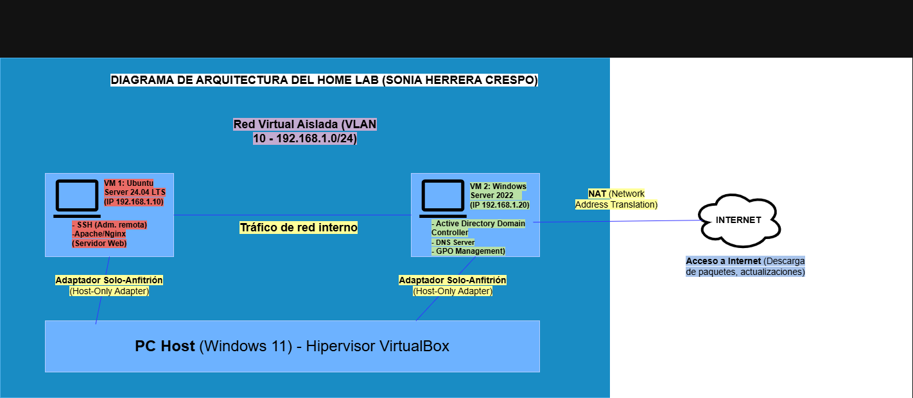

# 🖥️ Entorno Virtualizado de Pruebas y Administración de Redes (Home Lab)

Diseño, despliegue e implementación de un laboratorio local virtualizado orientado a la simulación de infraestructuras de red corporativas y la gestión de servicios en entornos híbridos (Linux y Windows).

## 🛠️ Arquitectura y Componentes del Sistema

El laboratorio se estructura sobre un hipervisor tipo 2 en un equipo anfitrión con Windows 11, interconectando diferentes máquinas virtuales mediante redes virtuales aisladas e interfaces de red estáticas:

* **Host Anfitrión (Hypervisor):** Windows 11 Pro / VirtualBox.
* **Nodo Servidor Linux:** Ubuntu Server (Administración remota vía SSH, cortafuegos perimetral con UFW).
* **Nodo Servidor Windows:** Windows Server 2022 (Controlador de Dominio, Active Directory, gestión de políticas GPO).
* **Estación de Trabajo Cliente:** Windows 10/11 simulando equipo corporativo integrado en dominio.

## 📊 Diagrama de Arquitectura

A continuación se muestra el esquema topológico de la red y la distribución de los servicios virtualizados:

## 📌 Competencias y Tareas Desarrolladas
* Configuración de adaptadores de red en modo Puente (*Bridged*) y Redes Privadas Anfitrionas (*Host-Only*).
* Direccionamiento IP estático y resolución de nombres locales mediante DNS.
* Despliegue, endurecimiento (*hardening*) y control de accesos en sistemas operativos de servidor.
* Simulación de incidencias de conectividad y diagnóstico de red mediante herramientas nativas.
